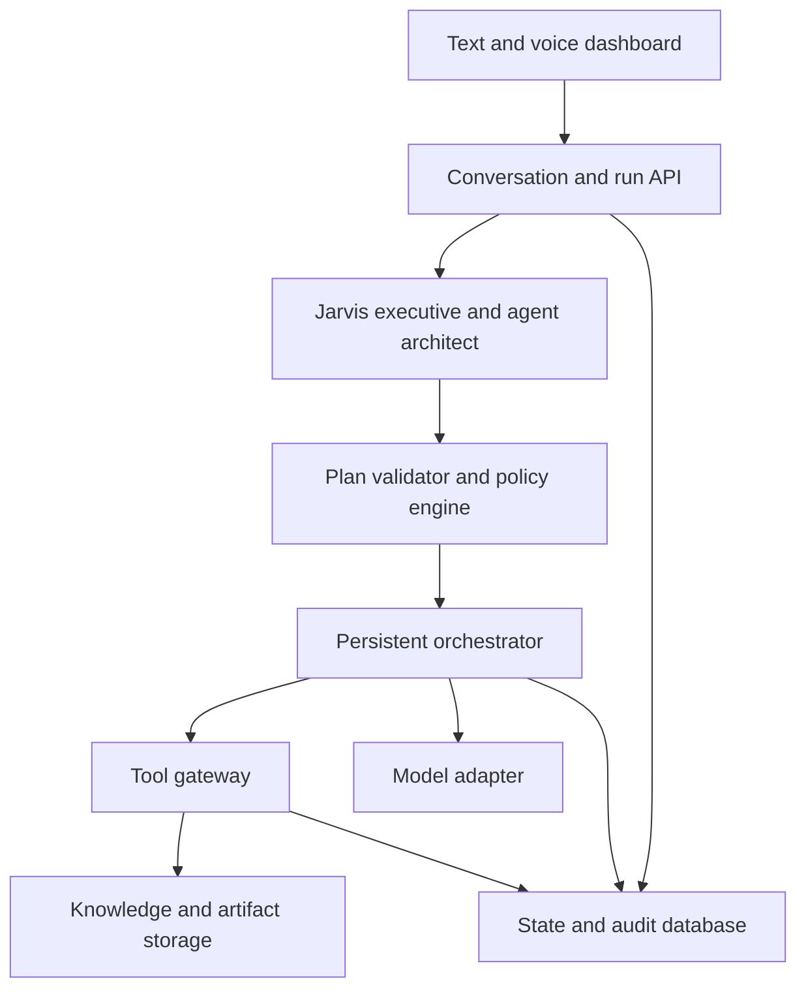

# System architecture

Status: proposed engineering design for the agreed product. No technology selection below is silently attributed to the user. See [ADR 0003](../project/adr/0003_STACK_AND_CLOUD.md).

## Logical boundaries

The executive is the owner-facing reasoning role. The architect proposes configurations and dependencies. Neither can approve its own proposal. The orchestrator is ordinary deterministic code controlling lifecycle and retries. Model calls happen inside bounded steps. The tool gateway is the only capability execution boundary. Policy enforcement is not a prompt.

These are logical modules, not a requirement for separate microservices. Start as a modular Python application. Introduce a separate worker process when persistent background work is implemented. Cloud deployment can reuse the same codebase for API and worker containers.

## Stack defaults and alternatives

| Layer | Proposed default | Reason and alternative |
|---|---|---|
| Backend | Python, FastAPI, typed validation with Pydantic | Fits existing skills and explicit contracts; another Python API framework would also work |
| First execution | Explicit deterministic workflow, then a small agent loop | Makes control flow visible before adopting an orchestration framework |
| Durable execution | Database-backed run/step records and worker leases | Reuse PostgreSQL; a dedicated workflow engine remains an open later choice if complexity demands it |
| Database | Local SQLite for the first slice, PostgreSQL before multi-tenant/concurrent execution | Removes initial service setup; migrate and test deliberately at J009 |
| Retrieval | Fixture lookup first, PostgreSQL/pgvector when grounded retrieval is added | Reuses RAG experience; lexical fallback remains useful without embedding credentials |
| Files | Local directory behind an adapter, later Azure Blob Storage | Keep file APIs independent of transport |
| Frontend | React and TypeScript | Fits the existing React background; build only at dashboard milestone |
| Streaming | Polling first, resumable server events later if needed | Progress reliability before transport sophistication |
| Models | Deterministic fixture adapter first; real provider adapter later | First milestone has no API key or paid dependency |
| Cloud | Azure Container Apps, Blob Storage, managed PostgreSQL, Key Vault and Azure Monitor | Already proposed in this discussion; Azure remains a default, not a prior user selection |
| Delivery | Docker and GitHub Actions; one IaC tool later | Already discussed cloud learning path; Bicep versus Terraform is deferred |

Select supported compatible package versions when implementing each task and commit a lockfile. No API version, model name, region, pricing, capacity or subscription is assumed here. A framework can replace an implementation detail only with a recorded comparison and preserved contracts.

## Storage responsibilities

- Relational store: identities, workspace membership, goals, facts, plan/config versions, runs, steps, tool calls, approvals, budget reservations, artifacts metadata, feedback, schedules and audit events.
- Object storage: source bytes and generated reports. Application metadata controls access. A storage path is not proof of permission.
- Retrieval index: derived chunks and optional embeddings keyed by workspace, source ID and source version. It is rebuildable, not the source of truth.
- Model context: a bounded selection of approved facts, sources and task outputs. Never the sole durable state.
- Development memory: repository `project/` files. They are separate from runtime business memory and never loaded from customer documents.

## Interaction contract

The client authenticates, submits an idempotent request, receives a run ID, and reads durable state. The executive proposes a plan. Validation produces an immutable validated plan reference. Policy either permits execution or creates a pending approval. The worker claims eligible steps, checks policy and budget, calls the model/tools, persists evidence and moves state transactionally. Losing a browser connection does not terminate durable work.

Authenticated server context supplies workspace and actor IDs. Model-supplied IDs are selectors to validate, never security authorities. Every read, write, cache key, artifact link and trace lookup includes workspace scope. Database row policies add defense in depth at J009; test with the actual non-owner runtime database role.

## Repository layout to create later

Proposed future directories: `backend/`, `frontend/`, `tests/`, `infra/`, `evals/`. This package does not create placeholder application implementations. Separate domain policy/orchestration from adapters for models, storage and speech so deterministic tests can run without network access.

Contract fields and conceptual endpoints are in [data contracts](12_DATA_API_CONTRACTS.md). Execution semantics are defined only in [orchestration](07_ORCHESTRATION.md); do not duplicate a conflicting state machine in a framework.
